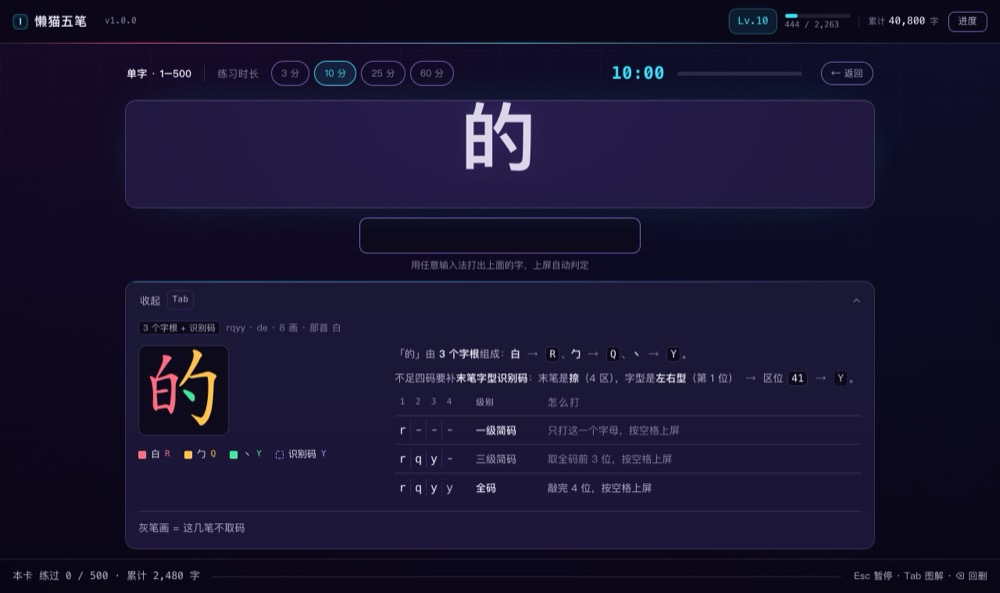

<p align="center"></p>

# 懒猫五笔

86 版五笔字型的练习器。纯前端、离线、零运行时依赖，构建产物是一个双击就能打开的单文件 HTML。


## 特点

打错的时候告诉你为什么。

一个字由哪几个字根组成、每个字根在哪个区、这一码为什么取它、四码不够时识别码怎么补——
按「区」上色画在同一张图上。颜色只有五种，和键盘分区一一对应。



## 功能

| | |
|---|---|
| **三段练习** | 字根（303 个 + 25 个一级简码，按字母键作答）→ 单字（3000 常用字）→ 词组（二字 / 三字 / 四字，各 1000 条） |
| **熟练度排队** | 每题按答对次数落位，刚练过的排到后面；同一张卡出题顺序固定 |
| **拆解图解** | 笔画按所属区上色、编码表（一级 / 二级 / 三级 / 全码）、识别码的取码理由 |
| **键盘图** | 25 键分区着色，点键帽查这个键下所有字根 |
| **练习数据** | 速度、准确率、平均码长、字数、用时 |
| **经验与等级** | 打对一个字 +1 经验，100 级曲线，等级表可查 |
| **自定义单字卡** | 粘贴一段文本，取其中的汉字（去重、按字频排序、上限 1000 个）练 |
| **进度** | 只存本机 localStorage，可导出成文件、在另一台机器导入 |

## 开始用

**在线**：<https://snihqi.github.io/lazycat-wubi/> —— 打开就能练，不需要注册。

**离线**：自己构建一个单文件版本，双击就能打开，不装东西、不联网。

```bash
npm install
npm run build:single   # → dist-single/index.html（4.2MB，双击即用）
```

**本地开发**：

```bash
npm run dev            # http://localhost:5183
npm run build          # 部署用产物 → dist/
npm run test           # 单测
npm run typecheck
```

## 部署

仓库自带 `.github/workflows/pages.yml`：推送到 `main` 就自动跑测试、构建，然后发布到 GitHub Pages。

站点地址 `https://<用户名>.github.io/<仓库名>/`，构建产物不提交进仓库，全部由 Actions 现算。

## 结构

```
src/core/     内核：队列、匹配器、计时器、经验曲线、字数统计
              —— 不碰 DOM、不读写 localStorage，纯函数 + 状态机
src/app/     界面层：路由、主页、练习页、拆解图、样式
              —— tokens.css 是颜色 / 字号 / 间距的唯一来源
src/data/     题库（构建产物，已入库）
scripts/      题库构建脚本
tests/        单测
tools/        audit-ui.mjs（对比度 / 控件边界 / 焦点可见性审计）、shot.mjs（单页截图）
```

技术栈：TypeScript + Vite，无框架、无运行时依赖。内核与界面分离，可以脱离浏览器直接测。

## 数据

| 数据 | 规模 | 来源 |
|---|---|---|
| 常用字 | 3000 | GB2312 字频表 |
| 词组 | 1000 × 3 | 语料整理 |
| 字根 | 303 + 25 简码 | 86 版字根表 |
| 笔画路径 | 3447 字 | [hanzi-writer-data](https://github.com/chanind/hanzi-writer-data)（MIT） |
| 编码 / 拆解 | 全表 | 86 版五笔规则整理 |

题库由 `npm run build:data` 生成，产物已提交。构建脚本读取的是本地参考资料目录，该目录不随仓库分发，日常开发不需要它。

## 已知限制

- 只为桌面设计（≥1024 宽），没有移动端布局。
- 单字练习依赖中文输入法上屏判定；纯字母键盘作答只用于字根卡。
- 词组练习的多字目标需要一次上屏整词。

## 许可

代码以 [AGPL-3.0-or-later](LICENSE) 发布。字形数据来自 hanzi-writer-data（MIT），版权归原作者。

版本记录见 [CHANGELOG.md](CHANGELOG.md)。
